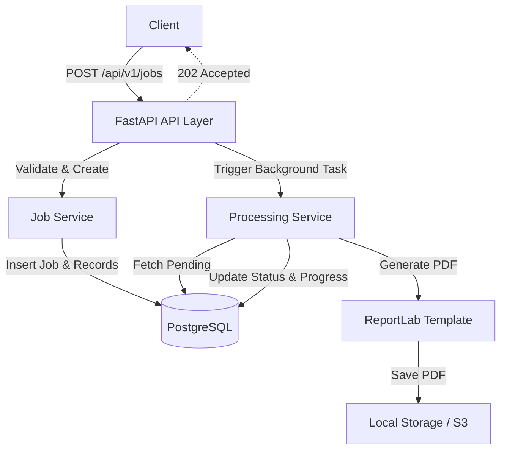
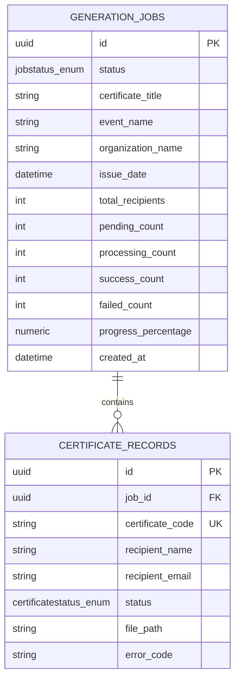
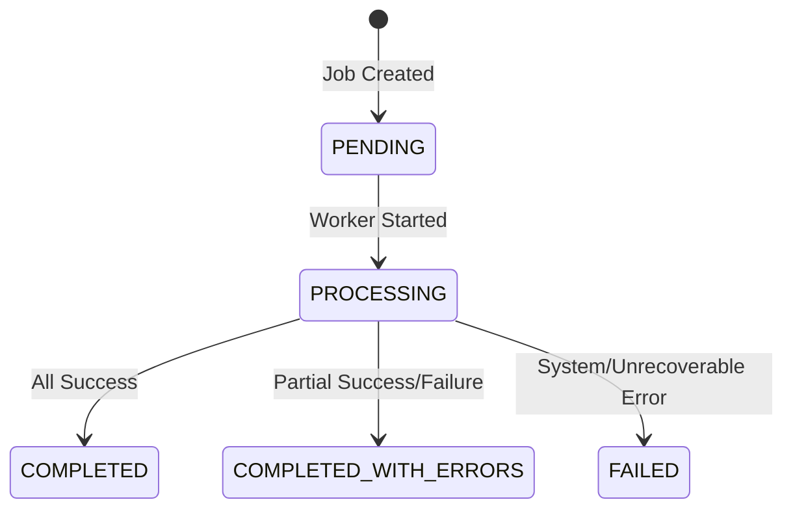

# Bulk Certificate Generator

## Overview
The **Bulk Certificate Generator** is a production-grade FastAPI application that solves the problem of generating hundreds or thousands of certificates simultaneously without blocking client requests. It implements asynchronous processing, failure isolation, and comprehensive error handling.

## Problem Solved
Generating PDF certificates is a CPU-intensive and I/O-bound operation. When processing hundreds of certificates sequentially within a single HTTP request, the client will likely experience a timeout. This application solves this by:
1. Validating the entire payload instantly.
2. Persisting the metadata.
3. Returning an HTTP 202 Accepted response.
4. Offloading PDF generation to a background worker.
5. Allowing clients to poll the job status and download certificates independently.

## Features
- **Bulk Job Creation**: Accept hundreds of recipients in a single POST request.
- **Background Processing**: PDF generation is decoupled from the main HTTP lifecycle.
- **Failure Isolation**: A failure in generating a single certificate (e.g., malformed name) will not abort the rest of the job.
- **Status & Progress Tracking**: Clients can check the progress (0-100%) and view precise successful/failed counts.
- **Resilient Database Transactions**: Proper transaction boundaries ensure that successful certificates are committed even if subsequent ones fail.
- **Scalable Architecture**: Can easily be transitioned from FastAPI `BackgroundTasks` to `Celery + Redis` without rewriting the core business logic.

## Architecture
The application follows a standard layered architecture:
- **API Layer**: FastAPI routers that handle HTTP interactions, schema validation, and dependency injection.
- **Service Layer**: Business logic for job creation, status updates, and background coordination.
- **Repository Layer**: Encapsulated database interactions (SQLAlchemy).
- **Worker Layer**: Independent modules for generating PDFs.
- **Storage Layer**: Abstractions over file storage (currently Local Storage, ready for AWS S3).



## Technology Stack
- **Framework**: FastAPI (Python 3.12+)
- **Database**: PostgreSQL
- **ORM**: SQLAlchemy 2.x
- **Migrations**: Alembic
- **Validation**: Pydantic v2
- **PDF Generation**: ReportLab
- **Testing**: pytest
- **Infrastructure**: Docker & Docker Compose

## Project Structure
```text
bulk-certificate-generator/
├── app/
│   ├── api/          # FastAPI routers and endpoints
│   ├── core/         # Settings, logging, exception handlers
│   ├── db/           # Database sessions and SQLAlchemy models
│   ├── repositories/ # Database query encapsulation
│   ├── schemas/      # Pydantic request/response models
│   ├── services/     # Core business logic
│   ├── templates/    # PDF Generation logic (ReportLab)
│   ├── workers/      # Background processing coordinators
│   └── storage/      # File storage abstractions
├── migrations/       # Alembic migrations
├── tests/            # Pytest test suites
├── .env.example      # Environment variables template
├── docker-compose.yml# Docker setup
└── requirements.txt  # Python dependencies
```

## Database Design



## Processing Flow & Failure Handling
When a job starts processing in the background:
1. The Job status changes to `PROCESSING`.
2. The worker iterates over all `PENDING` certificate records.
3. Each certificate is generated and committed in an **independent database transaction**.
4. If a certificate fails, the error is logged and its status is marked `FAILED`. The worker proceeds to the next certificate.
5. Counters (`success_count`, `failed_count`) are recalculated.
6. When all certificates are processed, the job completes. If any certificate failed, the job status becomes `COMPLETED_WITH_ERRORS`.

## Status State Machine



## Setup & Local Development

### 1. Environment Variables
Copy the `.env.example` file:
```bash
cp .env.example .env
```

### 2. Docker Setup (Recommended)
You can run the entire stack (API + PostgreSQL) via Docker Compose:
```bash
docker compose up --build -d
```
The API will be available at: `http://localhost:8000`
Swagger UI: `http://localhost:8000/docs`

### 3. Local Setup (Without Docker)
```bash
python -m venv venv
source venv/bin/activate  # On Windows: .\venv\Scripts\activate
pip install -r requirements.txt
alembic upgrade head
uvicorn app.main:app --reload
```

## Testing
The test suite utilizes `pytest` with an in-memory SQLite database to ensure robust testing of failure isolation and request validation.
```bash
# Run tests
pytest

# Expected Output
# tests/test_failure_isolation.py . 
# tests/test_health.py . 
# tests/test_job_creation.py . 
# tests/test_processing.py . 
# tests/test_validation.py .. 
```

## API Documentation

| Method | Endpoint | Purpose |
|--------|----------|---------|
| `POST` | `/api/v1/jobs` | Create a bulk generation job |
| `GET` | `/api/v1/jobs/{job_id}` | Get job status and progress |
| `GET` | `/api/v1/jobs/{job_id}/certificates`| List certificates for a job |
| `GET` | `/api/v1/certificates/{cert_id}` | Get certificate details |
| `GET` | `/api/v1/certificates/{cert_id}/download` | Download PDF |
| `GET` | `/api/v1/health` | Health check |

### Example Request (POST /api/v1/jobs)
```json
{
  "certificate_title": "Certificate of Participation",
  "event_name": "HackCellence 2026",
  "organization_name": "Example Organization",
  "issue_date": "2026-10-10",
  "recipients": [
    {
      "name": "Cheran S",
      "email": "cheran@example.com"
    },
    {
      "name": "Ezhilmaran E",
      "email": "ezhil@example.com"
    }
  ]
}
```

## Important Design Decisions

1. **202 Accepted Response**: Long-running jobs immediately yield a 202 Accepted response. This prevents client timeouts and HTTP connection exhaustion on the API server.
2. **Transaction Boundaries per Certificate**: By strictly isolating the commit boundary to each individual certificate during background processing, we ensure that a database exception for one user (e.g., a data truncation error) does not abort the entire job or roll back successful PDFs.
3. **Storage Abstraction**: File storage is abstracted behind a `LocalStorage` class. This allows easy migration to cloud object storage (AWS S3, GCS) by implementing a new class that conforms to the storage interface.
4. **Pydantic Validation**: Input validation strictly enforces non-empty whitespace strings and removes duplicate recipient emails automatically before database insertion.

## Scaling Strategy

Currently, the application utilizes FastAPI's native `BackgroundTasks`. For production workloads handling 100,000+ certificates:
1. **Message Broker Integration**: Replace `BackgroundTasks` with a dedicated distributed task queue like Celery running over Redis or RabbitMQ.
2. **Horizontal Worker Scaling**: Deploy multiple Celery worker pods independently of the API web pods.
3. **Chunking/Batching**: The job processor can spawn sub-tasks (e.g., chunking 100,000 recipients into 1,000 Celery tasks of 100 recipients each) to achieve massive parallelization.
4. **Object Storage**: Migrate from local volume storage to AWS S3, providing infinite capacity and offloading file-download bandwidth from the API servers directly to the clients via Presigned URLs.

## Security Considerations
1. **Path Traversal Protection**: The `download` endpoint enforces absolute paths and relies purely on UUID/Safe Code filenames, explicitly preventing arbitrary directory access.
2. **Error Masking**: Stack traces are caught by global exception handlers and logged internally. The client only receives standardized, safe error codes.
3. **UUIDs**: Predictable sequence IDs are avoided. All primary keys and endpoints operate strictly on UUIDv4 to prevent insecure direct object reference (IDOR) attacks.
